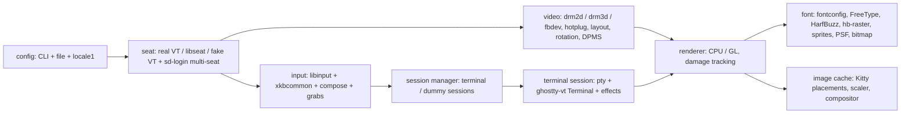
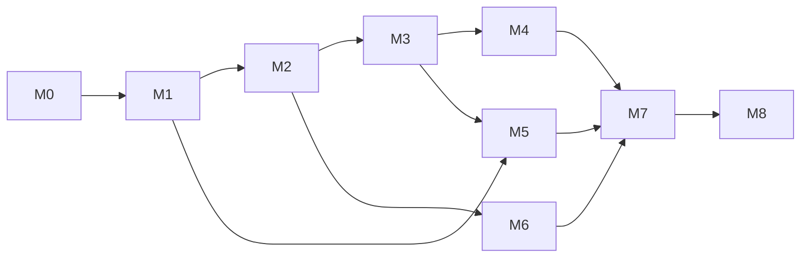

# kmshaunt roadmap

A Linux KMS/DRM console written in Zig on top of libghostty-vt. Goal: full feature
parity with kmscon 10.x, plus two things kmscon lacks:

- **R1** correct text: grapheme clusters, shaping, font fallback, color emoji,
  pixel-exact box drawing.
- **R2** Kitty graphics protocol images.

Name: **kmshaunt**. A haunt is the place a ghost lives in, and the VT is the
place libghostty lives in here. The binary is `kmshaunt`, the config is
`/etc/kmshaunt/kmshaunt.conf`, the units are `kmshaunt-vt@.service` and
`kmshaunt.service`, and the NixOS module is `services.kmshaunt`.

Estimate: about 10 weeks full-time, about 20 weeks part-time.

## 1. Facts this plan rests on

Checked on 2026-11-13.

| Fact | Source |
|---|---|
| libghostty-vt 1.0.1 builds only with Zig 0.17 | lib.ghostty.org/vt/installing.html |
| nixpkgs (26.11, f9a75f4) has `zig` 0.17.1, `zon2nix`, `kmscon` 10.1.0, `harfbuzz` 14.5.1 | `nix eval` |
| libghostty-vt exposes a C API with an ABI promise. A Zig build links it with `dep.artifact("ghostty-vt")`. The Zig module (`dep.module("ghostty-vt")`) has no such promise | installing.html |
| It provides render state with dirty rows, key, mouse, focus and paste encoders, selection, search, effects callbacks, Kitty graphics storage and placements | lib.ghostty.org/vt |
| It ships no PNG decoder. The host installs one with `GHOSTTY_SYS_OPT_DECODE_PNG` | guide-images.html |
| HarfBuzz `hb-raster` (stable since 13.0) rasterizes outlines and color paint graphs (COLR) to BGRA | harfbuzz.github.io/harfbuzz-hb-raster.html |
| The nixpkgs harfbuzz build does not ship `libharfbuzz-raster`, so an overlay must enable it | `ls` of the store path |
| nixpkgs `nixosTests.kmscon` boots kmscon with `hwaccel = true` and checks it with OCR | nixos/tests/kmscon.nix |
| The kmscon option set is listed in the appendix | kmscon `src/config.c` |

## 2. Decisions (defaults assumed by this plan)

| ID | Decision | Default | Alternative |
|---|---|---|---|
| D1 | libghostty binding | C API through `b.addTranslateC` of `ghostty/vt.h`, wrapped once in `src/vt.zig`, pinned to 1.0.1 in `build.zig.zon` | Zig module. Rejected: no stability promise, so every upgrade risks breakage |
| D2 | Threading | One thread, one epoll loop, frames paced by DRM page-flip events | Separate IO and render threads (Ghostty's model). Only if M8 numbers require it |
| D3 | C libraries | System libraries through `b.addTranslateC`: libdrm, gbm, EGL, GLESv2, libinput, libudev, xkbcommon, libseat, libsystemd (sd-login, sd-bus), fontconfig, FreeType, HarfBuzz (+raster) | Pure-Zig rewrites. Rejected: more work for no user-visible gain |
| D4 | PNG decoder for Kitty images | libspng (small, fuzzed by OSS-Fuzz) | `hb_raster_image_deserialize_from_png_or_fail` (no extra dependency, unknown hardening), wuffs |
| D5 | Config | Same option names, `no-` boolean prefix and file syntax as kmscon. File at `/etc/kmshaunt/kmshaunt.conf` | New format. Rejected: blocks migration and parity tests |
| D6 | `TERM` default | `xterm-ghostty`. The NixOS module installs Ghostty's terminfo | `xterm-256color` |
| D7 | Font rendering | FreeType for outlines and bitmap color glyphs (CBDT/sbix), `hb_raster_paint` for COLRv0/v1, HarfBuzz for shaping | Only HarfBuzz (no hinting) |

"Parity" means kmscon's user-visible behavior and options, not its internals.
`font-engine=pango` is accepted as an alias of `freetype`, because the FreeType
engine covers everything Pango did in kmscon.

## 3. Architecture



Source layout:

```
build.zig, build.zig.zon, deps.nix (zon2nix)
src/main.zig            startup, config, main loop
src/loop.zig            epoll, timerfd, signalfd
src/vt.zig              thin Zig wrapper over the libghostty-vt C API (only file that touches it)
src/config/             CLI + file parser, grabs, palettes
src/seat/               vt_real, libseat, vt_fake, multiseat (sd-login)
src/video/              drm (shared modeset, udev hotplug), drm2d, drm3d, fbdev, layout, dpms
src/input/              libinput, xkb (keymap, compose, repeat), xkb→ghostty key map, grabs
src/session/            manager, terminal (pty + ghostty-vt + effects), dummy
src/render/             frame walk + damage, cpu, gl, image
src/font/               discovery, face, shaper, color, atlas, sprite/, psf, bitmap
src/misc/               issue, asciicast, locale1, pty
tools/render_golden.zig headless renderer for tests (not installed)
nix/                    package.nix, module.nix, overlay.nix, tests/
```

## 4. Test strategy

| Layer | Tool | Covers |
|---|---|---|
| T1 Unit | `zig build test` | config and grab parsing, palettes, issue escapes, xkb→ghostty key table, cell-to-run grouping for shaping, layout math |
| T2 Headless render goldens | `tools/render_golden`: VT byte fixture + pinned fonts → PNG, compared byte-exact. Runs as a `nix flake check` derivation | R1 and R2 pixel output without a VM |
| T3 NixOS VM tests | `pkgs.testers.runNixOSTest`, `enableOCR`, `send_key`, `send_chars`, `send_monitor_command` (mouse), `screenshot` + Pillow compare, files written by the shell under test | everything that needs a real kernel: DRM, VT, input, logind, systemd units |
| T4 Parity tests | Every T3 behavior scenario runs twice: against `services.kmscon` and against `services.kmshaunt` | proof of parity. A scenario that passes on kmscon must pass on kmshaunt |
| T5 Real hardware | checklist in M8 | what QEMU cannot emulate |

VM setup:

- Fixed `virtualisation.resolution`, cursor blink off, pinned fonts. This makes
  screenshots deterministic, so they can be compared against goldens.
- drm2d runs on the default std VGA (bochs-drm). drm3d runs on Mesa llvmpipe with
  `hardware.graphics.enable`, as the nixpkgs kmscon test does.
- Multi-monitor uses `-device virtio-gpu-pci,max_outputs=2`.
- Mouse uses the QEMU USB tablet, which sends absolute pointer events. libinput
  absolute motion must be handled.
- DPMS state is read from `/sys/class/drm/card*-*/dpms`.

## 5. Milestones

Each milestone ends with green tests. Nothing merges with a red `nix flake check`.



### M0. Foundation (3 days)

1. Flake with Zig 0.17.1, dev shell, and the harfbuzz overlay with the raster
   library enabled. `flake.nix` follows the `just write-flake` convention.
2. `build.zig` with the `ghostty-vt` dependency pinned to 1.0.1, linked through
   `dep.artifact("ghostty-vt")`, `ghostty/vt.h` translated with `b.addTranslateC`,
   plus `deps.nix` generated by `zon2nix` so the Nix build works offline.
3. `nix/package.nix` and a `nix flake check` that runs T1 and builds the package.
4. A first VM test that boots and runs `kmshaunt --version`.

Exit: `nix flake check` is green, including the VM test.

### M1. First login on drm2d (1 week)

1. Epoll loop with timerfd and signalfd.
2. Real VT backend: `VT_SETMODE` with `VT_PROCESS`, `KD_GRAPHICS`, drop and take
   DRM master on switch away and back.
3. DRM modeset on the first connected connector, double-buffered dumb buffers,
   page flip.
4. pty + fork/exec of `/bin/login -p`, `TERM`, `reset-env`.
5. ghostty-vt `Terminal` + `RenderState`. The CPU renderer draws dirty rows with a
   single FreeType face, one codepoint per cell for now.
6. libinput + xkbcommon keyboard → xkb keycode to ghostty key table → key encoder
   → pty.
7. `kmshaunt-vt@.service` (Alias `autovt@`, `OnFailure=getty@%i`) and a PAM service.

Exit (T3):

- Autologin, then `echo $TERM > /tmp/t` returns `xterm-ghostty`.
- `ctrl-alt-f2` and back restores the screen.
- When the unit is killed, `getty@` takes over.

### M2. Terminal behavior completeness (1 week)

1. Effects: pty replies (DA, DSR, size reports), bell forwarded to the VT
   (`bell`), OSC 52 kept in an in-process clipboard, kmscon's private OSC
   `setBackground` / `setForeground` (release and retake DRM master for GUI
   launches) through the unknown-sequence effect.
2. Scrollback (`sb-size`) and the grabs `grab-scroll-*` and `grab-page-*`.
3. Mouse: libinput pointer, selection through the selection-gesture API,
   double-click word, copy, middle-click paste, mouse reporting to applications,
   `natural-scrolling`, software cursor.
4. `blink`, `backspace-delete`, palettes (all presets + custom), `oneshot`,
   `login`, `issue` and `issue-path` with agetty escapes, `asciicast` and
   `asciicast-loop`.
5. Resize on mode change, with reflow.

Exit (T3 + T4):

- Each item has a scenario, for example:
  - `printf '\e[c'` reply is captured by the shell.
  - Mouse select then middle-click pastes the text.
  - Shift+PgUp screenshot shows the earlier output.
  - `/etc/issue` text is visible by OCR before login.
- Every behavior scenario is green on both kmscon and kmshaunt.

### M3. Text rendering, solves R1 (2 weeks)

1. Font discovery with fontconfig: primary face, bold/italic/bold-italic faces,
   synthetic bold and italic when a face is missing.
2. Fallback chain: a per-codepoint face cache filled from `FcFontSort`.
3. Shaping: group cells into runs (same face, same style, no cursor split), shape
   with HarfBuzz, map clusters back to cells. Optional ligatures through a
   `font-features` option (default off).
4. Graphemes: draw the full cluster from `GRAPHEMES_UTF8`. ZWJ sequences, flags,
   skin tones, VS15 and VS16, and combining marks all come out of shaping. Cell
   width always comes from libghostty, and the glyph is fitted into 1 or 2 cells.
5. Color glyphs: CBDT and sbix through FreeType `FT_LOAD_COLOR`, COLRv0 and v1
   through `hb_raster_paint`.
6. Sprites drawn in code, so lines join exactly across cells: box drawing, block
   elements, braille, Powerline, Symbols for Legacy Computing (sextants, octants).
7. Decorations: underline styles (single, double, curly, dotted, dashed),
   underline color, strikethrough, overline, faint, inverse, invisible. Cursor
   styles.
8. Glyph atlas with LRU eviction. `font-size` auto mode computed from the
   connector's physical size in mm. `grab-zoom-in` and `grab-zoom-out`.
9. Other engines for parity: `psf` (console fonts such as Terminus), and the
   built-in `unifont` and `8x16` bitmap fonts as a last resort when fontconfig
   finds nothing.

Exit (T2): goldens for each case with pinned JetBrains Mono, Noto Color Emoji
(CBDT), a COLRv1 emoji font and Noto Sans CJK:

- ZWJ family, flags, skin tones, VS16
- Combining marks, CJK wide characters
- Box drawing grid joints
- Each underline style
- Bold and italic fallback

Exit (T3): `cat` of the same fixture matches the VM screenshot golden.

### M4. Kitty graphics, solves R2 (1 week)

1. Install the libspng decoder at startup, before any other library use (the
   setting is process-global).
2. Image cache keyed by (protocol, image id, generation). Scaled copies cached by
   destination size.
3. CPU compositor: read the placement list from the render state, sort by layer
   (below background, below text, above text) and then by z, clip to the
   viewport, bilinear-scale the source rectangle, alpha blend.
4. Animations as libghostty reports frames.
5. Options: `kitty-image-storage-limit`. Kitty file, temp-file and shared-memory
   media stay off whenever the process runs as root (see R3).

Exit:

- T2 goldens from raw escape fixtures: placement, cropping, z-order across all
  three layers, scrolling an image off screen, delete commands.
- T3: `kitten icat` of a test PNG matches the screenshot golden.

### M5. Video parity (1.5 weeks)

1. drm3d: GBM + EGL + GLES2 renderer with a glyph atlas texture and image
   textures. `hwaccel` selects it.
2. fbdev backend (`no-drm`).
3. `gpus=all|primary|aux`, `use-original-mode`, `mode=` per GPU and connector.
4. `multi-monitor=clone|largest|scaled`. `screen=` rotation and disable per
   connector. `grab-rotate-cw` and `grab-rotate-ccw`.
5. udev hotplug for connectors and GPUs.
6. `dpms-timeout`: screen off after inactivity, on with any input.
7. Hardware cursor plane, with `soft-cursor` to force the software cursor.

Exit (T3 + T4):

- The same scenarios pass on drm2d, drm3d (llvmpipe) and fbdev.
- Two-output clone and scaled goldens.
- Rotation goldens for all four orientations.
- The connector's sysfs `dpms` file reads `Off` after the timeout and `On`
  after a keypress.

### M6. Seats and sessions (1 week)

1. libseat backend (`libseat`).
2. Multi-seat daemon (`kmshaunt.service`): sd-login seat monitoring, fake VT
   for seats without VTs.
3. Session manager: `session-max`, `session-control`, `grab-terminal-new`,
   `grab-session-next`, `grab-session-prev`, `grab-session-close`, dummy session.
4. `grab-reboot`, following `/proc/sys/kernel/ctrl-alt-del`.
5. xkb: `xkb-model`, `xkb-layout`, `xkb-variant`, `xkb-options`, `xkb-keymap`,
   `xkb-compose-file`, `xkb-repeat-delay`, `xkb-repeat-rate`. org.freedesktop.locale1
   is read through sd-bus at start and followed live.

Exit (T3 + T4):

- `localectl set-x11-keymap de` swaps the y and z keys without a restart.
- A compose sequence produces the expected character.
- Session grabs create, cycle and close sessions.
- A second seat gets its own console. This depends on Q1.

### M7. Config, CLI, NixOS module (4 days)

1. Full kmscon-compatible CLI and config file, with `--help`, `--version`,
   `verbose`, `debug`, `silent` and `configdir`.
2. Man pages for `kmshaunt(1)` and `kmshaunt.conf(5)`.
3. `services.kmshaunt` module: `enable`, `package`, `config`, `extraOptions`,
   `useXkbConfig`, fonts. It installs the units, the PAM service and the
   terminfo, and replaces `autovt@`.
4. Parity matrix (appendix) fully ticked.

Exit: the T4 suite is green on both implementations for every row of the
appendix.

### M8. Performance and real hardware (1 week)

1. vtebench throughput compared with kmscon on the same VM. Target: equal or
   better on every benchmark.
2. Damage-only presentation: `drmModeDirtyFB` on drm2d, partial redraw on drm3d.
3. Memory with 10,000 lines of scrollback per session.
4. T5 real-hardware checklist:
   - Drivers: amdgpu, i915/xe, nouveau, nvidia-drm.
   - HiDPI auto font size.
   - Monitor hotplug.
   - DPMS really powers the panel off.
   - VT switch to and from a Wayland session.
   - Hardware cursor plane.
   - Input latency compared with kmscon.

Exit: numbers recorded in `docs/perf.md`. Checklist done on at least two GPU
vendors.

## 6. Risks

| ID | Risk | Mitigation |
|---|---|---|
| R3 | The VT unit runs as root, so untrusted image data is parsed as root, and Kitty file and shared-memory media could read root-only files | Those media are off whenever euid is 0. libspng is fuzzed. Storage limit enforced. Landlock and seccomp after init are a candidate addition after M8 |
| R5 | QEMU can't test real GPU drivers, hardware cursor planes, physical DPMS or latency | T5 checklist in M8 |
| R6 | Font determinism: a FreeType or HarfBuzz update changes pixels and breaks goldens | Versions pinned by `flake.lock`. A `just update-goldens` recipe and a review of the image diff on every lock bump |
| R7 | nixpkgs harfbuzz lacks the raster library | Overlay in M0. Upstream a nixpkgs PR to enable it |

## 7. Open questions

- **Q1.** Can QEMU route a second USB keyboard to seat1 from the test driver? HMP
  `sendkey` has no device argument, QMP `input-send-event` does. Spike at the
  start of M6. If it fails, the multi-seat input check moves to T5.
- **Q2.** Is libspng's API usable with the allocator libghostty passes to the
  decode callback, or does the output need a copy? Check at the start of M4.

## Appendix. Parity matrix (kmscon 10.x options)

| Group | kmscon options | Milestone |
|---|---|---|
| Global | `help`, `version`, `verbose`, `debug`, `silent`, `configdir` | M7 |
| Seat | `vt`, `switchvt`, `libseat` | M1, M6 |
| Session | `session-max`, `session-control` | M6 |
| Terminal | `issue`, `issue-path`, `asciicast`, `asciicast-loop`, `login`, `oneshot`, `term`, `reset-env`, `backspace-delete`, `sb-size`, `bell`, `blink` | M1, M2 |
| Input | `xkb-model`, `xkb-layout`, `xkb-variant`, `xkb-options`, `xkb-keymap`, `xkb-compose-file`, `xkb-repeat-delay`, `xkb-repeat-rate`, `mouse`, `natural-scrolling`, `soft-cursor`, `dpms-timeout` | M1, M2, M5, M6 |
| Grabs | `grab-scroll-up`, `grab-scroll-down`, `grab-page-up`, `grab-page-down`, `grab-zoom-in`, `grab-zoom-out`, `grab-session-next`, `grab-session-prev`, `grab-session-close`, `grab-terminal-new`, `grab-rotate-cw`, `grab-rotate-ccw`, `grab-reboot` | M2, M3, M5, M6 |
| Video | `drm`, `hwaccel`, `gpus`, `use-original-mode`, `mode`, `multi-monitor`, `screen` | M5 |
| Font | `font-engine` (`freetype`, `pango` alias, `psf`, `unifont`, `8x16`), `font-size`, `font-name` | M3 |
| Palette | `palette` (solarized, solarized-black, solarized-white, soft-black, base16-dark, base16-light, vga, legacy, custom), `palette-*` | M2 |
| Private OSC | `setBackground`, `setForeground` | M2 |
| System | `kmshaunt-vt@.service` as `autovt@` with getty fallback, multi-seat `kmshaunt.service`, PAM service, locale1 xkb | M1, M6, M7 |
