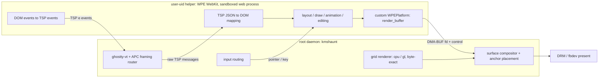
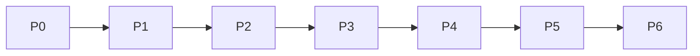

# kmshaunt roadmap: Tern Surface Protocol (TSP)

A Linux KMS/DRM console written in Zig on top of libghostty-vt. The kmscon
parity foundation is complete. Its plan is archived at
[`docs/archive/ROADMAP-kmscon-parity.md`](docs/archive/ROADMAP-kmscon-parity.md)
(milestones M0–M8, the parity matrix, and the original decisions D1–D7).

This roadmap adds the next capability: **full TSP parity**. TSP lets a program
in a pane describe its UI as a tree of semantic nodes. The terminal lays the
tree out, draws it, and animates it natively. The program stops painting cells.

The goal is a console that gives GUI niceties without a graphical system. A
logged-in user runs a TSP program (the first consumer is omp) and gets native
surfaces: cards, tables, forms, progress, editors. The pre-login console stays
a plain, fast, reliable cell grid.

**TSP is a compile-time option.** The default build links no web engine and
stays the lean standalone console it is today. TSP is built only when asked
for (`-Dtsp=true`). This keeps the engine's footprint and attack surface out
of every build that does not need it.

Name and units are unchanged: binary `kmshaunt`, config
`/etc/kmshaunt/kmshaunt.conf`, units `kmshaunt-vt@.service` and
`kmshaunt.service`, NixOS module `services.kmshaunt`.

Estimate: about 15–22 weeks full-time, for the TSP-enabled build. P2 (the kind
mapping) dominates. Packaging is de-risked by an existing WPE WebKit flake
(see §1); the remaining wildcard is the mapping volume.

## 1. Facts this plan rests on

Checked on 2026-11-14.

| Fact | Source |
|---|---|
| TSP travels in-band on the pty as APC strings: `ESC _ tsp;<verb>[;k=v]*;<JSON> ESC \`. Verbs `q/o/f/b/s/x` go program→terminal, `r/e` go terminal→program. | docs.stencil.so/tern/protocol/transport.html |
| The terminal answers `hello` before the DA1 reply. The reply advertises `kinds` and `features`. A kind not listed falls back to pre-rendered ANSI `rows`. | protocol/handshake.html |
| A surface occupies exactly one grid row (its anchor) but draws at natural height between grid runs. Modes: `inline`, `screen`, `flow`. Regions: `main`, `dock`, `layer`. Lifecycle binds to the anchor row, OSC 133;A, process exit, and RIS. | protocol/surfaces.html |
| The document is an id-addressed node tree of ~73 kinds, changed by atomic frames of ops. Flow control: 2 unacknowledged frames, ack per drawn frame. Retention: 64 MiB per pane, settled nodes evicted with `gone`. | protocol/documents.html, protocol/operations.html |
| Limits: one APC string 262144 bytes, chunk body 65536, joined frame 400 MB, one blob 16 MiB, 200000 nodes per surface, depth 64, 256 KiB CSS per surface. | protocol/operations.html |
| WPEPlatform is the stable WPE integration API since WPE WebKit 2.54. libwpe and Cog are deprecated. Built-in platforms: Wayland, DRM/KMS, headless. | wpewebkit.org/blog/2026-10-06-wpe-platform.html |
| The web process renders into DMA-BUF (or SHM) buffers shared with the UI process. A platform captures them by subclassing `WPEView` and implementing `render_buffer`. | wpewebkit.org/reference/2.54.0/wpe-platform-2.0/overview.html |
| `WPEBufferDMABuf` exposes fd, FourCC format, modifier, stride, offset, plane count, width, height. `WPEBuffer` imports to an EGL image or to CPU pixels, and carries release/rendering fences. | reference/.../class.BufferDMABuf.html |
| `WPESettings` exposes dark mode, reduced motion, and contrast. These map to TSP `dark` and `reduceMotion`. | reference/.../overview.html |
| `eval-exec/nix-wpe-webkit` packages `wpewebkit` 2.52.3 with `ENABLE_WPE_PLATFORM=true`, pkg-config `wpe-webkit-2.0`, bubblewrap + libseccomp + xdg-dbus-proxy (sandbox), and libdrm/libgbm/mesa/libepoxy (graphics). It ships a flake overlay and the public `nix-wpe-webkit.cachix.org` cache, where 2.52.3 is prebuilt (narinfo verified). | github.com/eval-exec/nix-wpe-webkit, pkgs/wpewebkit.nix, ci.yml |
| The pinned nixpkgs (`d4f25a3e5620`) has `libwpe`, `libwpe-fdo`, `webkitgtk_4_1/6_0`, `cog 0.2.4`, but no `wpewebkit`. The flake above supplies it. | `nix eval` on the flake input |
| The default kmshaunt binary is standalone and statically linked against libghostty-vt, with no shared-lib rpath. TSP must not add a web engine to it. | nix/package.nix header |
| kmshaunt wraps the ghostty-vt `unknown_sequence` effect (APC+OSC). `setEffects` sets `UNKNOWN_MAX_BYTES` to 2048 (src/vt.zig:1232). `APC_MAX_BYTES` is a separate option. `effUnknown` handles only the kmscon private OSCs today. | src/vt.zig, src/session/terminal.zig |
| The pty reply path is inline during the drain, so a hello reply written in `effUnknown` precedes the DA1 reply. | src/session/terminal.zig |
| A session draws into `RenderContext.fb` plus a damage list. The video backend presents through `endFrame`. Sessions never present or flip. | src/session.zig |
| The terminal session spawns `cfg.login_argv` (`/bin/login -p`) as root and drains the pty. It does not track the uid transition after login. | src/session/terminal.zig |
| Video backends: drm2d (dumb buffers), drm3d (GBM+EGL+GLES2), fbdev. | src/video/ |
| The kmscon parity foundation is complete: M8.1 equal-or-better on all vtebench, T4 parity green on both nodes, T2/T3 goldens pixel-exact, plus ghostty pixel-parity and notcurses perf work. | git log, docs/archive/ROADMAP-kmscon-parity.md |

## 2. Decisions

| ID | Decision | Default | Alternative |
|---|---|---|---|
| D1 | Render engine | WPE WebKit (WPEPlatform), packaged via the `eval-exec/nix-wpe-webkit` flake input. Use 2.52.3 from its Cachix (verified cached); no bump. Target the 2.52.3 WPEPlatform API. | WebKitGTK `webkitgtk_6_0`. Packaged in nixpkgs, but pulls GTK4 and gives a less direct offscreen path. Rejected for the helper. |
| D2 | Scope | TSP is post-login only. The root pre-login console never renders TSP. | TSP everywhere. Rejected: it forces untrusted rendering into the root console. |
| D3 | Buffer capture | A custom WPEPlatform module subclasses `WPEDisplay`/`WPEView`/`WPEToplevel`. Its `render_buffer` vfunc exports `WPEBufferDMABuf` to the daemon. | The built-in headless platform. Less control over buffer hand-off and input. |
| D4 | Privilege | The helper runs as the logged-in uid. WebKit spawns its own sandboxed web process. The root daemon parses no untrusted JSON, CSS, or HTML. It does framing only. | Single root process. Rejected: it points a full web engine at untrusted pty output as root. |
| D5 | Grid renderer | Unchanged. The CPU/GL grid renderer and its byte-exact goldens stay. TSP surfaces composite as separate buffers at their anchors. | Render the whole pane in the engine. Rejected: it throws away the parity renderer and its determinism. |
| D6 | IPC | Unix socket with `SCM_RIGHTS` DMA-BUF fd passing. A small control + event protocol. | sd-bus. Heavier for a per-session buffer stream. |
| D7 | TSP test model | DOM/event assertions, tolerant screenshots, and tern-sdk conformance. Separate from the grid goldens. The T4 grid parity suite must stay green. | Byte-exact goldens for surfaces. Rejected: engine rasterization drifts across versions and GPUs. |
| D8 | TSP is a compile-time option | `zig build -Dtsp=true`, default false. The default build compiles out `src/tsp/` and the helper and links no WPE. A runtime `tsp` config gates TSP within a TSP-enabled build. `TERM_PROGRAM=kmshaunt` (not `tern`). | Runtime-only opt-in. Rejected: it leaves the engine in every binary and breaks the standalone default. |
| D9 | Privilege-handoff trigger | A PAM session hook (`pam_exec`) notifies the daemon of the uid at session open. Resolve in P1 (Q1). | Detect the uid from the pty slave owner, or watch the child uid transition. |
| D10 | Build flavors | `kmshaunt` (no TSP, standalone) and `kmshaunt-tsp` (daemon TSP code + the helper). The helper is a separate executable that links WPE. The daemon stays static. The NixOS module selects the flavor. | One binary that always links WPE. Rejected: see D8. |

"Full parity" means the TSP v1 kind vocabulary, features, events, and limits,
not Tern's own app chrome (media viewer, image zoom viewer, spell checker).
Kinds the console cannot honor are not advertised in the hello reply.

## 3. Architecture

The split is by privilege and by test model. The root daemon keeps the grid.
A per-session user-uid helper renders surfaces with WPE WebKit. They exchange
buffers and events over a socket.

Everything TSP is gated by the compile-time option. With `-Dtsp=false` (the
default), `src/tsp/` and the helper are not compiled and no WPE is linked. The
daemon's TSP code (framing, routing, anchoring, compositing) is pure Zig on top
of libdrm/gbm/EGL, which the daemon already links. WPE lives only in the helper
executable, built only with `-Dtsp=true`.



Root daemon responsibilities (bounded, no untrusted parsing):

- APC framing and chunk reassembly, with the spec limits enforced.
- Route raw `tsp;` messages to the helper. Install the OSC 133 and OSC 7501
  effects for lifecycle.
- Place surface buffers at their anchors in the grid arithmetic. Composite
  them with the grid output. Feed content height back.
- Route pointer and key events. Arbitrate focus between grid and surface.

Helper responsibilities (unprivileged, sandboxed):

- Parse TSP JSON. Map kinds to HTML+CSS, theme tokens to CSS variables, and
  frames/ops to DOM mutations. The protocol's "what a node becomes" section is
  the mapping spec.
- Layout, drawing, animation, native editing, selection, IME, event generation.
- Render offscreen to DMA-BUF. Export buffers through the custom platform.
- Bridge DOM events back to TSP `e` events. Decode blobs.

Source layout (new code, all under the `-Dtsp` gate):

```
build.zig                  -Dtsp option -> build_options.tsp; helper target
src/tsp/transport.zig      APC framing, chunking, limits (root)
src/tsp/router.zig         message routing, surface control protocol (root)
src/tsp/anchor.zig         anchor placement, height feedback, lifecycle (root)
src/render/composite.zig   DMA-BUF import + blit/texture into fb (root)
helper/                    WPE UI-process app (user uid), built only with -Dtsp
  platform/                custom WPEPlatform module (render_buffer export)
  mapping/                 TSP kinds -> HTML+CSS, theme tokens
  events/                  DOM -> TSP event bridge, native editing, forms
  blobs/                   SHA-256 store, disk cache
  ipc.c                    socket + SCM_RIGHTS buffer passing
tools/tsp_play.zig         JSONL recording replay harness
nix/wpewebkit.nix          follows the eval-exec flake input (2.52.3, cached)
```

## 4. Test strategy

| Layer | Tool | Covers |
|---|---|---|
| T1 Unit | `zig build test` | APC framing, chunk reassembly, limits, op application, anchor arithmetic, IPC framing. Hermetic, no engine. |
| T2 Surface goldens | headless helper + tolerant screenshot compare | Kind rendering and layout. Tolerant (perceptual diff), not byte-exact. Pinned fonts and engine version. |
| T3 NixOS VM | `runNixOSTest`, real omp | End-to-end surfaces on a real kernel: login handoff, DRM compositing, input, VT switch, multi-seat. |
| T4 Grid parity | the archived parity suite | The grid renderer stays byte-exact. Must remain green on every milestone. |
| Conformance | tern-sdk fixtures + omp recordings | Wire correctness against the four SDKs and a real program. JSONL replay via `tools/tsp_play.zig`. |
| T5 Real hardware | checklist in P6 | GPU vendors, llvmpipe fallback, hotplug, latency. |

Both flavors are tested. The default `-Dtsp=false` build is the parity
baseline: T1 and T4 run against it and must behave exactly as today, with no
WPE linkage. The `-Dtsp=true` build adds T2, T3, and conformance. CI builds and
tests both.

The recording format is Tern's JSONL (`PI_TUI_TSP_RECORD`), replayed with the
`surface-play` semantics. Record a real omp session in Tern to seed the
fixtures. The four client SDKs (Rust, Python, Go, TypeScript in
`stencil-hq/tern-sdk`) agree byte for byte on the wire and bound the mapping.

## 5. Milestones

Each milestone ends with green tests. Nothing merges with a red `nix flake
check`. The T4 grid parity suite must stay green throughout, on the default
no-TSP build.



### P0. Build gate, engine bring-up, and buffer pipeline (1–2 weeks)

The riskiest milestone. It proves the approach before any mapping work.

1. Add the compile-time gate. `build.zig` exposes `-Dtsp` (default false) through
   `build_options.tsp`. Gate `src/tsp/` and the helper target on it. Add the
   `kmshaunt` and `kmshaunt-tsp` Nix flavors (D10). Prove the default build is
   unchanged and links no WPE.
2. Add the WPE WebKit flake input (`eval-exec/nix-wpe-webkit`, overlay) and the
   `nix-wpe-webkit.cachix.org` substituter. Use the cached 2.52.3 `out` output
   (no build). Verify the 2.52.3 WPEPlatform headers expose `render_buffer` and
   `WPEBufferDMABuf`. The 2.54 reference docs are the guide, not the target.
3. Build the helper skeleton: a WPE UI-process app that creates a headless
   `WPEDisplay` and a `WebKitWebView`, loads static HTML, and runs the GLib loop.
4. Write the custom WPEPlatform module. Subclass `WPEDisplay`, `WPEView`, and
   `WPEToplevel`. Implement `render_buffer` to capture `WPEBufferDMABuf`
   (fd, format, modifier, stride, offset, width, height).
5. Prove both import paths: `import_to_egl_image` for drm3d and
   `import_to_pixels` for drm2d. Handle release fences.
6. Composite one static surface into kmshaunt's DRM output at a fixed rect.

Exit: the default no-TSP build is byte-for-byte the current console. With
`-Dtsp=true`, one static surface is visible on both drm2d and drm3d.
`wpewebkit` 2.52.3 substitutes from the cache. The llvmpipe footprint on drm2d
is measured and recorded (Q4).

### P1. Decoupling contract and privilege handoff (2–3 weeks)

1. Define the daemon↔helper IPC: unix socket, `SCM_RIGHTS` DMA-BUF passing,
   control messages (surface open/close, anchor, height, damage), event messages
   (TSP `e` → pty input), and input messages (pointer/key → helper).
2. Add the root TSP router, gated by `build_options.tsp`. Extend `effUnknown` to
   route `tsp;` APCs. Raise `UNKNOWN_MAX_BYTES` from 2048 to 262144 and set
   `APC_MAX_BYTES`. Add chunk reassembly and the spec limits. No JSON/CSS/HTML
   parsing in root.
3. Resolve the privilege-handoff trigger (D9, Q1). Spawn the helper as the
   logged-in uid. WebKit spawns its sandboxed web process. Tear down on session
   end and VT switch.
4. Implement anchor placement in the grid arithmetic and height feedback. One
   helper per session for multi-seat.

Exit: the helper runs unprivileged. The daemon routes APCs. Spawn and teardown
are clean across login, VT switch, and session end. T4 grid parity stays green.

### P2. Transport, handshake, surfaces, and the kind mapping (4–6 weeks)

The bulk of the work. Mechanical HTML/CSS authoring against the spec, not
engine building.

1. Handshake: answer `hello` before DA1 with `kinds`, `features`, `apc`,
   `credits`, `cols`, `cell`, `dark`, `reduceMotion`, `hour12`. Answer the
   `blobs` query. Set `TERM_PROGRAM=kmshaunt`.
2. Surfaces: `inline`/`screen`/`flow` modes, regions `main`/`dock`/`layer`,
   open/close/adopt/replace/suspend/resume, `listen:false`, `font` sans/mono.
3. Document: the full op set (`add/set/text/splice/move/del/settle/focus/
   reveal/scroll`), atomic frames, per-op error events, UTF-16 splice indices.
4. The mapping layer: all ~73 kinds to HTML+CSS per "what a node becomes".
   Theme tokens to CSS variables. Frames to DOM mutations. `WPESettings` for
   dark and reduce-motion.
5. Flow control: credits/ack tied to drawn frames.

Exit: a recorded omp session replays and renders with the full kind set.
tern-sdk conformance fixtures pass. T2 surface goldens are green for the
advertised kinds.

### P3. Input and interaction (3–4 weeks)

1. Pointer routing: daemon `InputEvent` → helper `WPEView` events. Hit-testing
   in the engine.
2. Actions: click/dblclick/menu, toggle/copy/open/select/activate, context menus.
3. Focus management. The native-editing bridge (`edit`/`undo`/`send`, UTF-16,
   selection). Typeahead.
4. Form values (`el` form subset). Per-kind events (list, table, tabs, select,
   switch, slider, and the rest).
5. IME preedit through `WPEInputMethodContext`, within the console's limits.

Exit: the spec's interactive radio-form demo works end to end with the mouse.
Native-editing events round-trip. Form `values` match the spec algorithm.

### P4. Persistence, blobs, and retention (2–3 weeks)

1. Anchor lifecycle: scrollback integration, `gone` on anchor loss, OSC 133;A
   prompt disposal, process exit, RIS, alternate screen.
2. Retention budget (64 MiB), settle/eviction order, `gone` events.
3. Blobs: SHA-256 content-addressed store, disk cache, `blobs` query,
   `TERN_BLOB_DIR`. Images handed to the engine to decode.
4. Snapshots: replay hello + surfaces + sheets + a whole-document frame, if
   session persistence is in scope (Q3).
5. Scroll anchoring and virtualization for long documents.

Exit: surfaces survive scroll, resize, and VT switch. Images persist across a
restart. Retention evicts in the spec order.

### P5. Stylesheets and rich text (2–3 weeks)

1. The `s` verb: scoped CSS. The engine's CSS engine handles most of it. Confine
   selectors to the surface, drop `url()` and `position: fixed`, ignore
   `@font-face`, and report parse errors.
2. Load the sans face and Nerd Font icon glyphs into the engine.
3. Polish `md`, `code` (highlighting), `diff`, `ansi`, and `math`.

Exit: program stylesheets apply within scope. Sans surfaces follow the design
guide. Rich-text kinds render.

### P6. Hardening, performance, and real hardware (2 weeks)

1. Sandbox configuration (WebKit bubblewrap). seccomp/landlock on the daemon
   framing path.
2. Fuzz the daemon APC/framing parser. Enforce every spec limit.
3. Performance: virtualization, damage-only compositing, memory under long
   transcripts, multi-seat stress.
4. T5 real-hardware checklist: amdgpu, i915/xe, nouveau, nvidia-drm. llvmpipe
   fallback. Hotplug. VT switch to and from a Wayland session. Input latency.
5. Flip the runtime `tsp` default on within the TSP flavor (D8) once the gates
   pass. The compile-time default stays off.

Exit: security and performance gates pass. The checklist is done on at least
two GPU vendors. Numbers recorded in `docs/perf.md`.

## 6. Risks

| ID | Risk | Mitigation |
|---|---|---|
| R1 | The cached package is 2.52.3, while the reference docs describe the 2.54 WPEPlatform API. Symbols may differ. | 2.52.3 is prebuilt in `nix-wpe-webkit.cachix.org` (no build). P0 verifies `render_buffer`/`WPEBufferDMABuf` against the 2.52.3 headers. |
| R2 | DMA-BUF import into drm2d/drm3d, EGL/GBM sharing, fences, two producers into one display. | The P0 spike proves both import paths before any mapping work. |
| R3 | The mapping volume: ~73 kinds plus CSS plus events. Mechanical but large. | tern-sdk fixtures and omp recordings bound it. The protocol's HTML mapping is the spec. |
| R4 | WPE version and security churn, GPU/llvmpipe footprint. The WPEPlatform API moved between 2.52 and 2.54. | Pin 2.52.3 (cached) and target its API. Track security advisories. Measure the llvmpipe path in P0. The compile-time gate keeps WPE out of the default build. |
| R5 | Lifecycle races: the login trigger, VT switch, multi-seat teardown. | The IPC contract covers them. P1 tests exercise each transition. |
| R6 | Bounded APC parsing still runs in root. | Enforce limits and fuzz the framing path (P6). Root parses no JSON/CSS/HTML. |
| R7 | Console gaps: no full IME, no desktop browser for `open`/`media`. | Do not advertise kinds the console cannot honor. The hello `kinds` list is the contract. |

## 7. Open questions

- **Q1.** Privilege-handoff trigger: a PAM `pam_exec` session hook, or detect
  the uid from the pty slave owner? Spike at the start of P1. The hook is the
  robust path. The slave-owner path avoids a PAM change.
- **Q2. (Resolved)** WPE WebKit version: 2.52.3 is in `nix-wpe-webkit.cachix.org`
  (narinfo verified), so use 2.52.3 as-is. No bump. Target the 2.52.3 WPEPlatform
  API and verify its symbols in P0.
- **Q3.** Are session persistence and snapshots in scope? kmshaunt has no
  session daemon. Snapshots map to a restore-on-restart feature, not a live
  daemon. Decide at the start of P4.
- **Q4.** drm2d has no GPU. WPE still needs a GL context (llvmpipe). Is the
  footprint acceptable for the target user? Measure in P0.

## Appendix A. TSP limits (enforced by the daemon and helper)

| Limit | Value |
|---|---|
| One APC string | 262144 bytes |
| Chunk body (`apc`) | 65536 bytes |
| One chunked frame | 400000000 bytes joined |
| One other chunked message | 24 MiB joined |
| Chunk idle timeout | 1 s |
| One blob | 16 MiB decoded |
| Blobs per screen | 256 MiB |
| Blobs on disk | 1 GiB |
| Nodes per surface | 200000 |
| Depth | 64 levels |
| CSS per surface | 256 KiB |
| Surface state per pane | 64 MiB |
| Unacknowledged frames (`credits`) | 2 |

## Appendix B. Kind coverage

The hello reply advertises only kinds the helper draws. The full v1 vocabulary
(grouped), tracked as a checklist during P2–P5:

| Group | Kinds |
|---|---|
| Layout | col, row, card, section, rule, spacer, split, scroll, empty |
| Text and code | text, md, code, diff, ansi, rows, math |
| Data | kv, stats, table, tree, json, badge, kbd, icon, avatar, avatars, image, media, carousel, attachment |
| Lists and navigation | list, item, tabs, picker, menu, menubar, nav, breadcrumb, pager |
| Progress and motion | spinner, shimmer, skeleton, elapsed, rate, progress, meter, chart, effort |
| Inputs | editor, input, button, buttons, select, switch, slider, otp, calendar, date, field |
| Chrome | status, seg, toast, overlay |
| Agent and task | tool, agent, trace, checklist, message, suggestions, questions, stacktrace, block, prefs |
| HTML | el |

Terminal features advertised as they land: `blobs`, `settle`, `adopt`, `dock`,
`reduce-motion`, `aside`, `scroll`, `styles`, `flow`, `font`. Kinds that need
Tern app chrome the console cannot provide (`media` viewer, `image` zoom) are
drawn inline only or omitted from the reply.